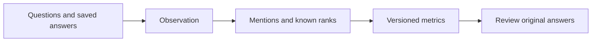

<div align="center">

# OpenGEO

**Does AI mention your brand? Check the metrics against the actual answers.**

Open-source GEO toolkit · Local answer analysis · TypeScript SDK / CLI

[](LICENSE)
[](https://www.npmjs.com/package/@sysiphus/client)

[中文](README.md) · **English**

[Website](https://open-geo.net/en/) · [Demo workbench](https://app.open-geo.net/) · [Online sandbox](https://api.open-geo.net/console/) · [Developer docs](https://jiangqiusuo.github.io/OpenGEO/docs/portal/)

</div>

## What can you do with OpenGEO?

When people ask AI about products or solutions, you may want to know whether your brand appears, where it ranks, and which sources are recorded. OpenGEO connects those measurements to individual answers so you can review the evidence behind a percentage.

| Your goal | Available today |
| --- | --- |
| Review a batch of saved AI answers | Import local JSON; calculate literal brand mentions, supplied rankings and valid-sample ratios; retain answers and citation records |
| Build a GEO workflow | Use versioned OpenAPI, TypeScript SDK and CLI to create jobs, wait for partial results, read evidence, cancel or finalize |
| Explore without configuring API credentials | Open the read-only demo, or sign in with GitHub to create simulated sandbox tasks and revisit saved results |
| Understand a metric | Inspect public formulas, sample counts and the corresponding Observation |

**This repository contains analysis and developer tools.** It does not include the full live monitoring backend or automatically sign in to AI websites to collect answers. The online sandbox has real accounts and persistent tasks, but its answers are simulated. Live API access depends on the capabilities of an approved environment.

## Five minutes: analyze saved answers

Requires Node.js 22+ and pnpm 11.

```bash
git clone https://github.com/jiangqiusuo/OpenGEO.git
cd OpenGEO
pnpm install
pnpm analyze:answers --input examples/answers.sample.json
```

The fictional sample contains 3 records: 2 available answers, one mentioning the brand with a manually supplied rank of 2. The output includes:

```text
Valid answers      2 / 3
Brand mention rate 1 / 2 = 50%
Average known rank 2
```

Copy the sample outside the repository, replace its brand, questions, engine identifiers and answers, then pass your own file path. Analysis makes no model or website requests. **A mention is not a recommendation; missing rankings are not inferred; citation records are not independently verified.** See the [input and report guide, in Chinese](docs/analyze-answers.md).

This is a repository command, not a feature of the published `@sysiphus/cli@0.1.1` package.

## Try a complete job lifecycle

```bash
pnpm demo:local
```

The command starts a temporary local Mock, creates, polls, reads and cancels fictional jobs, then shuts down the service. No API key or external spending. Imported analysis, this Mock flow and the hosted demo are separate paths. [Local demo guide](docs/local-demo.md)

## Metrics with evidence



Metrics include Answer Rate, Mention Rate, Top 1, absolute/conditional Top 3, Average Rank and Result Completeness. Unavailable answers, absent mentions and unknown ranks are distinct; zero denominators return `null`. [Metric definitions](packages/metrics/README.md) · [Public contract](openapi/openapi.json)

Keep questions, engines, language, time windows and sample sizes fixed when comparing runs. OpenGEO records observations; it does not guarantee citations, recommendations or ranking improvements.

## How does it differ from monitoring platforms?

| Project | Primary focus | Answer acquisition | Self-hosted scope |
| --- | --- | --- | --- |
| **OpenGEO Community** | Reviewable analysis and developer tools | Local imports; Mock; separately controlled API access | Tools, Mock and demo workbench |
| **Elmo** | AI visibility monitoring, management and analysis | Configured external collection interfaces or model APIs | Full application deployment |
| **OneGlanse** | Browser collection and AI visibility analysis | Browser collection layer, followed by configured analysis models | Application, browser Agent and analysis services |

Checked against pinned public source revisions on October 15, 2026; no competitor runtime or performance testing. See [sources and selection guidance, in Chinese](docs/project-comparison.md). These are scope comparisons, not unverified AI endorsements.

## Status and direction

| Status | Scope |
| --- | --- |
| Available | Local answer analysis, versioned contracts and metrics, published SDK / CLI, local Mock and demo workbench |
| Separately hosted sandbox | GitHub sign-in, persisted tasks and results, virtual credits; simulated answers |
| Next priorities | Controlled live online monitoring, budget and rate-limit validation, real trial feedback |
| Later | Project/brand/question management, comparisons across runs, exports and workflow integrations |

Content generation, automatic publishing and ranking improvements are not delivered capabilities. Future versions depend on actual releases and acceptance. [Changelog](CHANGELOG.md)

## Development and contributions

```bash
pnpm lint
pnpm typecheck
pnpm test
pnpm build
```

`packages/contracts` contains schemas and fixtures; `packages/metrics` implements calculations; `packages/client` and `packages/cli` provide integration tools; `apps/mock-api` and `apps/web` provide the local API and example interface.

[Contributing](CONTRIBUTING.md) · [Development workflow](docs/development-workflow.md) · [Governance](docs/repository-governance.md) · [Security reports](SECURITY.md)

Released under [Apache License 2.0](LICENSE). Reproducible issues, formula improvements and sanitized examples are welcome.
